# LinkedIn Review — a multi-agent career reviewer

A Claude Code multi-agent system that reviews a LinkedIn profile and the career behind it
on **two time horizons**. A scraper reads the live profile through Claude in Chrome, a
**Recruiter** agent (next 1–12 months) and a **Career Coach** agent (next 2–3 years) work
in parallel from public market sources, and a **Synthesis** agent merges both into one
validated run. A private web app shows the result on desktop and iPhone, and a 3D
**Office** tab replays each run with the agents as toy robots at their desks.

One command runs everything: `/linkedin-review`.

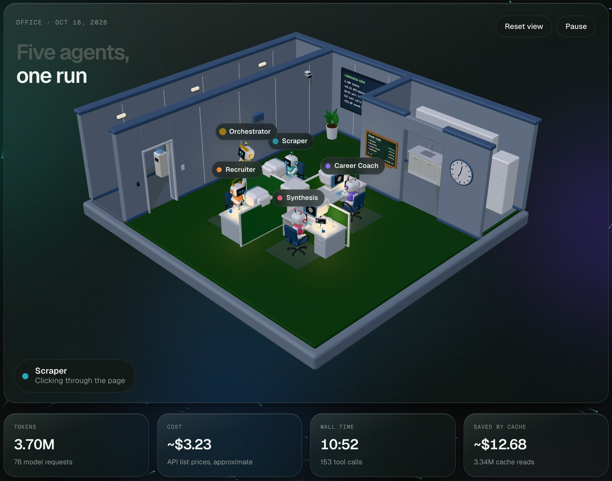


---

## Contents

- [What it does](#what-it-does)
- [Features](#features)
- [Architecture](#architecture)
- [The agents](#the-agents)
- [A run, step by step](#a-run-step-by-step)
- [Results and metrics](#results-and-metrics)
- [The web app](#the-web-app)
- [The Office](#the-office)
- [Design choices](#design-choices)
- [Project layout](#project-layout)
- [Run it yourself](#run-it-yourself)
- [Security and privacy](#security-and-privacy)
- [Limitations](#limitations)
- [Author & Certifications](#-author--certifications)

## What it does

A single "review my LinkedIn" prompt mixes two different jobs: fixing profile copy this
month and choosing where a career should be in three years. Asked together, one model
does both badly. So the system:

- **Splits the horizons.** The Recruiter owns the profile and the job search (score,
  skill gaps, paste-ready edits, salary bands, search keywords). The Career Coach owns
  strategy (industry, company size, target role, country, IC vs management, skill
  mandates) and is forbidden from commenting on LinkedIn copy.
- **Grounds every market claim.** Each claim cites a source the agent opened during that
  run: the WEF *Future of Jobs* report, the US BLS *Occupational Outlook Handbook*,
  salary aggregates and job boards.
- **Never invents data.** If the scraper could not read a field, it stays `null` with a
  `missing_fields` note; analysis agents never fill the gap.
- **Remembers settled facts.** A shared `known_context.md` is read first by every agent,
  so a confirmed fact (an employer's rebrand, for example) is never raised as a finding again.
- **Tracks change over time.** Each run lists what changed since the previous one, and the
  app keeps every run so scores and plans can be compared.

## Features

| Area | Feature |
|---|---|
| **Orchestration** | `/linkedin-review` Claude Code skill runs a 7-step pipeline (preflight → scrape → parallel analysis → synthesis → validate + publish → stats → report) |
| **Collection** | Claude in Chrome reads the signed-in profile: header, About, experience, skills, certifications, projects, recommendations and posts with engagement; falls back to scrolling, section reads and screenshots on lazy-loaded pages |
| **Parallel analysis** | Recruiter and Career Coach run as independent subagents in their own contexts, at the same time, from the same profile JSON |
| **Cited research** | Coach sources `s*`, recruiter sources `r*`; every claim, mandate and change points at one, and the app shows them in a Sources tab |
| **Merge without rewriting** | Synthesis builds a week / month / quarter plan, "changes since last run" and notes where the two agents disagree, keeping both views |
| **Validation** | `validate_run.py` checks schema version, required sections, size and that every change, mandate and source reference resolves before anything is published |
| **Agent telemetry** | `agent_stats.py` reads the Claude Code transcripts and records tokens, approximate cost, timing and tool-call kinds per agent (numbers only) |
| **Web app** | One vanilla-JS HTML file, six tabs, light/dark, mobile bottom bar; served by Apps Script and by Cloudflare Pages (home-screen app on iPhone) |
| **The Office** | three.js replay of each run: robots, desks, speech bubbles from real tool calls, run timeline, cost breakdown, run comparison |

## Architecture

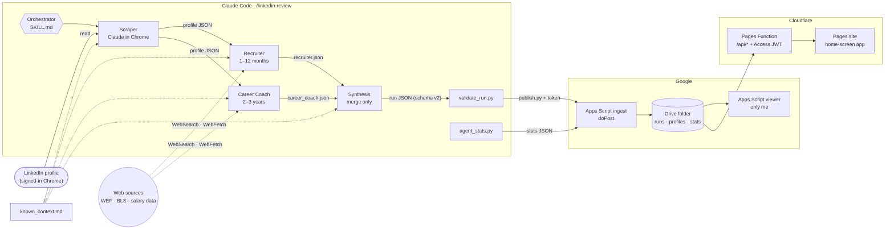

`Index.html` (the app) and `Office.html` (the 3D tab) are the same files on both hosts:
a small shim sends data calls to `google.script.run` inside Apps Script and to
`POST /api/<fn>` on Cloudflare.

## The agents

| Agent | Horizon | Tools | Output |
|---|---|---|---|
| **Orchestrator** | — | Agent, Bash | Run id, preflight checks, launches subagents, validates, publishes, reports |
| **Scraper** | today | Claude in Chrome (navigate, read page, JS, screenshots) | `data/profiles/RUN_ID.json` in the shape of `data/schema.json` |
| **Recruiter** | 1–12 months | WebSearch, WebFetch | Score /100, 8-dimension scorecard, 10 answered sections, ranked paste-ready `changes`, salary bands (USD remote + COP), keywords, sources `r*` |
| **Career Coach** | 2–3 years | WebSearch, WebFetch | 7 strategic answers, 4–6 "master X within N months" mandates, country comparison, market signals, SWOT, skip-for-now, sources `s*` |
| **Synthesis** | merge | Read, Write | One schema-v2 run: summary, this week / month / quarter plan, changes since last run, disagreement notes |

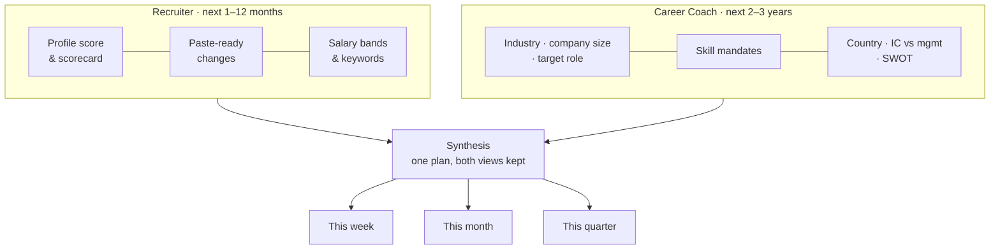

## A run, step by step

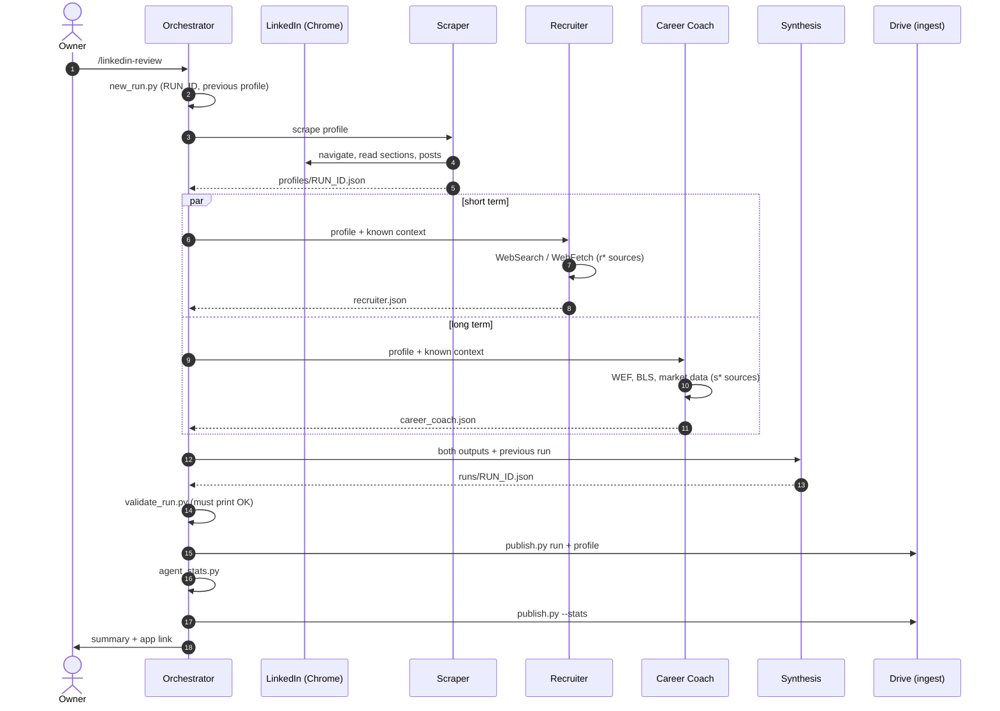

| Step | Who | Does |
|---|---|---|
| 0 | Orchestrator | `new_run.py` makes `RUN_ID` (`r<YYYYMMDD>-<HHMM>`, Bogotá time), checks `.env` and the Chrome tools |
| 1 | Scraper | Reads the profile into `data/profiles/RUN_ID.json`; carries over lists LinkedIn fails to render and says so |
| 2 | Recruiter ∥ Career Coach | Run in parallel, each writes one JSON file to `data/work/<RUN_ID>/` |
| 3 | Synthesis | Merges into `data/runs/RUN_ID.json` (schema v2) |
| 4 | Orchestrator | `validate_run.py` → `publish.py` to the Apps Script ingest endpoint |
| 5 | Orchestrator | `agent_stats.py` → `publish.py --stats` for the Office tab |
| 6 | Orchestrator | Short report: score, top changes, plan, what changed |

## Results and metrics

Figures below come from the latest run, `r20261018-1824`, and the stats file
`agent_stats.py` wrote for it. Input and cache tokens are exact; output tokens are
estimated from visible text, so **costs are approximate API list prices**, not a
subscription charge.

### Run at a glance

| Wall time | Tokens | Model requests | Tool calls | Cost (approx.) | Saved by cache |
|:-:|:-:|:-:|:-:|:-:|:-:|
| **10:52** | **3.70M** | **78** | **153** | **~$3.23** | **~$12.68** |

| Sources cited | Paste-ready changes | Skill mandates | Plan items | Disagreement notes |
|:-:|:-:|:-:|:-:|:-:|
| **54** (38 coach · 16 recruiter) | **12** | **6** | **14** (4 week · 5 month · 5 quarter) | **15** |

### Timeline

The recruiter and the coach start the same second and work side by side; synthesis waits
for both.

```mermaid
gantt
    title Run r20261018-1824 (mm:ss from start)
    dateFormat HH:mm:ss
    axisFormat %M:%S
    section Orchestrator
    Preflight, launch, publish :done, 00:00:00, 00:10:52
    section Scraper
    Read profile (Chrome)      :active, 00:00:12, 00:03:59
    section Recruiter
    Short-term review          :crit, 00:04:10, 00:07:58
    section Career Coach
    Long-term strategy         :crit, 00:04:10, 00:09:32
    section Synthesis
    Merge + plan               :00:09:40, 00:10:37
```

### Tokens and cost by agent

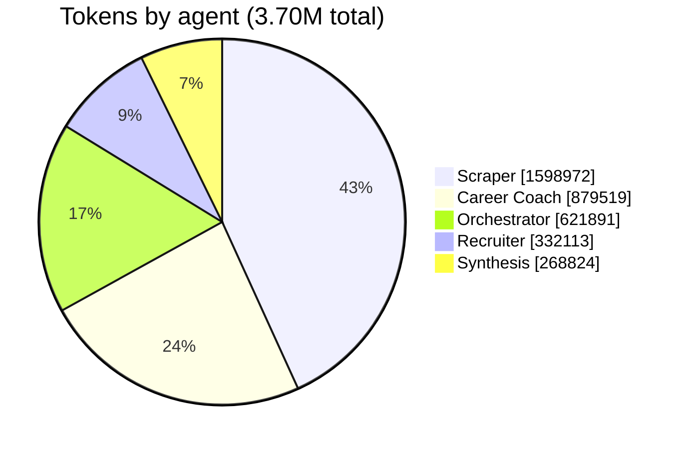

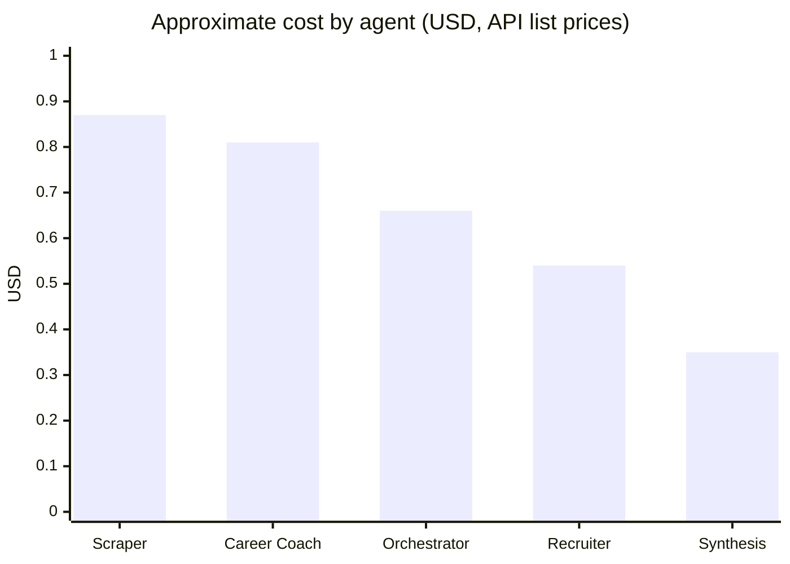

| Agent | Model | Tokens | Requests | Tool calls | Main tools | Duration | Cost ≈ |
|---|---|--:|--:|--:|---|--:|--:|
| Orchestrator | Opus 5.5 | 621,891 | 11 | 10 | Agent, Bash | 10:52 | $0.66 |
| Scraper | Opus 5.5 | 1,598,972 | 26 | 56 | Chrome: 25 clicks/screens, 12 JS reads, 7 navigations | 3:47 | $0.87 |
| Recruiter | Opus 5.5 | 332,113 | 11 | 25 | 16 WebFetch, 2 WebSearch | 3:48 | $0.54 |
| Career Coach | Opus 5.5 | 879,519 | 22 | 52 | 37 WebFetch, 2 WebSearch | 5:22 | $0.81 |
| Synthesis | Opus 5.5 | 268,824 | 8 | 10 | Read, Bash | 0:57 | $0.35 |
| **Total** | | **3,701,319** | **78** | **153** | | **10:52** | **$3.23** |

The scraper is the most expensive agent: every screenshot and page read of a
lazy-loaded LinkedIn page goes back into its context. **90% of all tokens are cache
reads** (3.34M), which is why the cache saves about four times what the run costs.

### Tool calls by kind

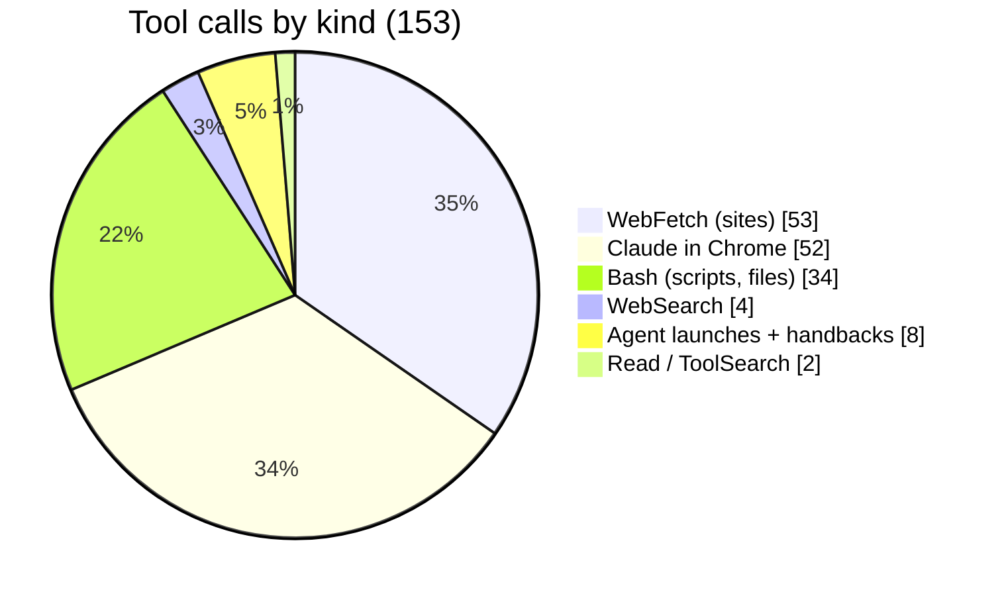

The most-opened source hosts this run: levels.fyi (10), bls.gov (4), certdemand.com (4),
axialsearch.com (3), fred.stlouisfed.org, terminal.io, revelo.com and hireinsouth.com (2 each),
plus the WEF Future of Jobs 2025 report.

### Run over run

| Run | Wall time | Tokens | Tool calls | Cost ≈ |
|---|--:|--:|--:|--:|
| `r20261018-0748` (first with stats) | 17:36 | 5.53M | 197 | $3.99 |
| `r20261018-1824` | 10:52 | 3.70M | 153 | $3.23 |
| **Change** | **−38%** | **−33%** | **−22%** | **−19%** |

Most of the drop is the Career Coach: 21 web searches in the first run, 2 in the second,
once the known-context file and earlier sources covered the ground.

### Profile score across runs

Recruiter score /100 for the four schema-v2 runs, as profile changes from earlier runs
were applied:

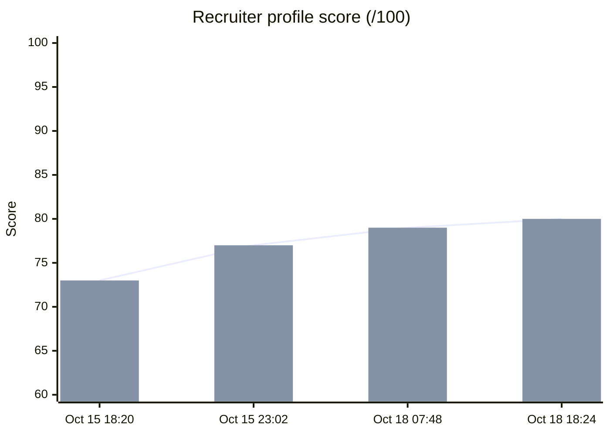

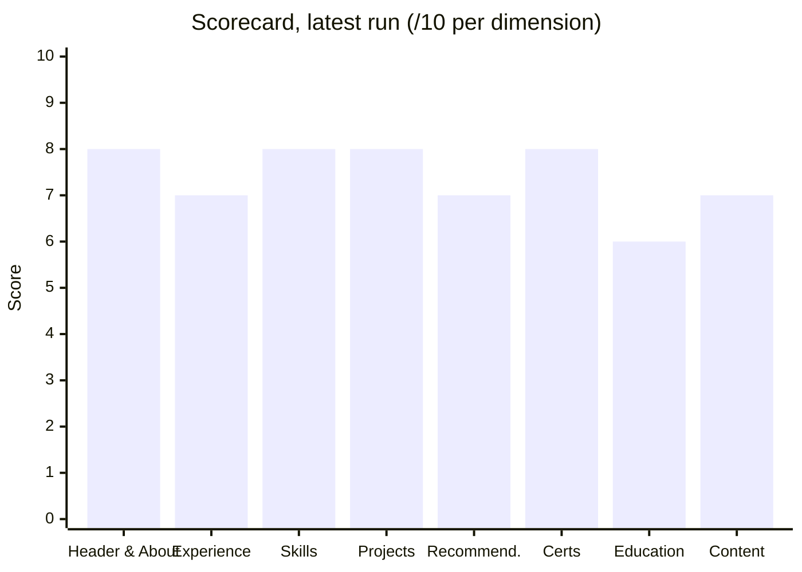

| Dimension | Oct 15 18:20 | Oct 15 23:02 | Oct 18 07:48 | Oct 18 18:24 |
|---|:-:|:-:|:-:|:-:|
| Header & About | 7 | 8 | 9 | 8 |
| Experience | 7 | 7 | 7 | 7 |
| Skills & keywords | 8 | 8 | 8 | 8 |
| Projects | 7 | 8 | 8 | 8 |
| Recommendations | 6 | 6 | 6 | **7** |
| Certifications | 8 | 7 | 8 | 8 |
| Education | 6 | 6 | 6 | 6 |
| Content & visibility | 7 | 7 | 7 | 7 |
| **Total /100** | **73** | **77** | **79** | **80** |

Runs are probabilistic: the same profile can move a point between runs (Header & About
9 → 8). Cited sources, the known-context file and the validator keep that drift small.

## The web app

A private dashboard over the Drive folder, served two ways: Google Apps Script (deployed
"Only myself") and Cloudflare Pages behind Cloudflare Access (installable as a
home-screen app on iPhone). A run picker switches between every published run.

| Tab | Shows |
|---|---|
| **Overview** | The headline recommendation, top profile fixes, this week's actions |
| **Office** | The 3D pipeline replay and agent metrics (below) |
| **Career** | Coach answers, skill mandates, country comparison, market signals, SWOT, skip-for-now |
| **Profile** | Score, scorecard, skill gaps, paste-ready changes with copy buttons |
| **Actions** | Week / month / quarter plan with a checklist saved to Drive |
| **Sources** | Every source opened in the run, grouped by agent |

<p>
  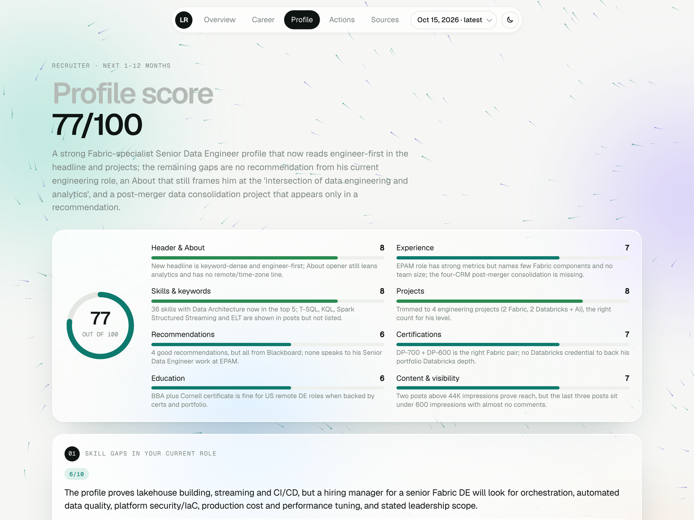
  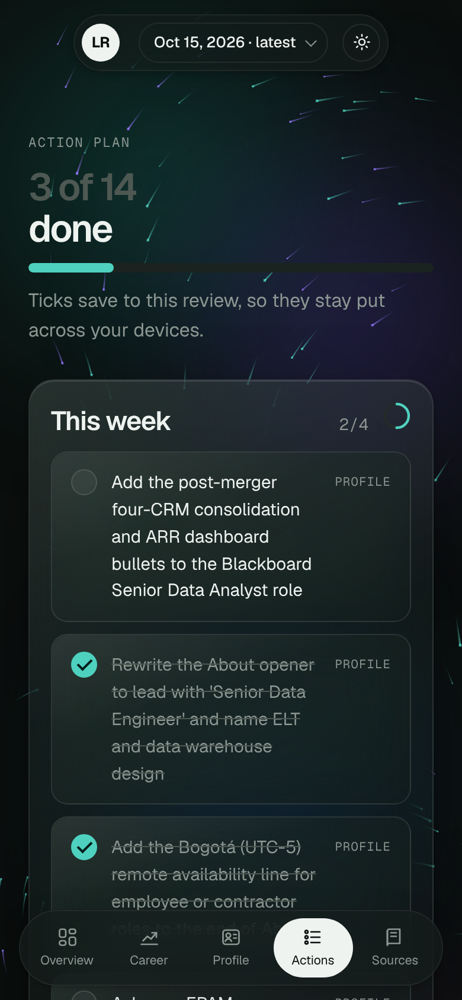
</p>

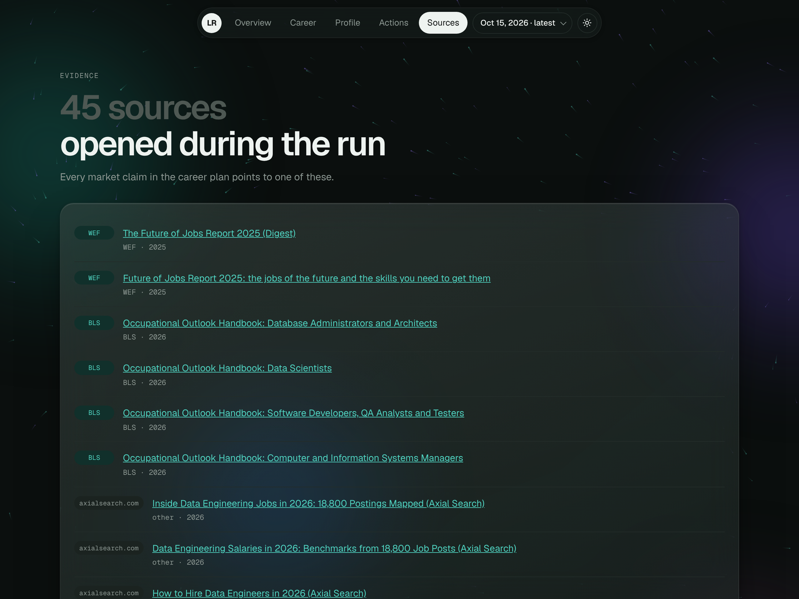

## The Office

A 3D tab (`apps-script/viewer/Office.html`, three.js 0.170 ES modules from jsDelivr,
loaded the first time the tab opens) that shows the **pipeline**, not the analysis.

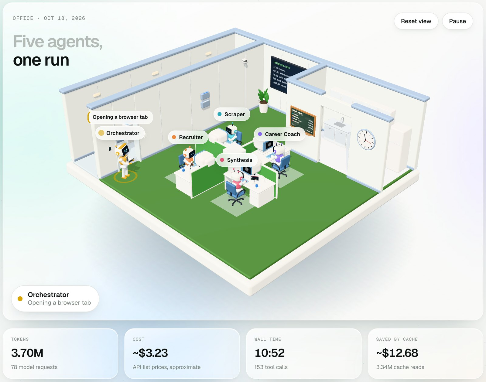

- A cut-away office with a pinwheel of desks: the Scraper, Recruiter, Career Coach and
  Synthesis robots type at retro terminals; the Orchestrator robot walks over to brief each one.
- The run replays at 16×: documents fly from desk to desk at each hand-off, speech bubbles
  and a status pill show what each robot is doing from its real tool calls (searching,
  reading a site, writing a file), and desk displays count tool calls.
- Finished agents take a coffee break in the kitchen; a live Break room board and a wall
  screen show who is working and the run totals.
- Click any robot for a frosted card with its goal, tokens, cost, time and tool calls.
  Drag to turn, scroll to zoom.
- Under the scene: totals, a **Run replay** timeline, **Where the cost goes** by token type
  and **Compare runs** across every run with stats. It follows the app's run picker.

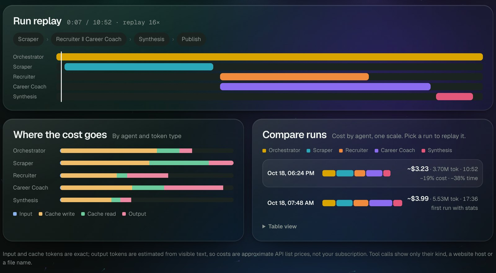

The data comes from `scripts/agent_stats.py`, which writes only numbers, tool-event kinds,
website hosts and generic file names; never prompts, search queries, commands or profile content.

## Design choices

- **Two horizons, two agents.** Profile tweaks and career strategy pulled each other off
  course in one prompt. The recruiter owns the profile; the coach is forbidden from
  commenting on LinkedIn copy.
- **Shared known context.** Confirmed facts live in one file every agent reads first,
  instead of being patched into each prompt after a bad run.
- **Disagreements are kept, not hidden.** When the two agents give different salary bands
  or opposite advice, synthesis keeps both and writes a note.
- **Probabilistic, not deterministic.** Mitigations: cited sources, the known-context file,
  a scraper "carry-over" rule for lists LinkedIn fails to render, and `validate_run.py`
  checking ids and references before anything is published.
- **Local by design.** Scraping needs a signed-in, interactive Chrome session, so the
  pipeline runs on a Mac, not in CI.
- **No framework.** The app is one HTML file (vanilla JS, glassmorphism cards, a canvas
  particle field, light/dark). Python scripts use only the standard library.
- **Two hosts, one file.** Apps Script serves the page inside a Google iframe, so iOS never
  sees an app icon. Cloudflare Pages serves the same page with a home-screen icon and
  manifest; a Pages Function reads the same Drive folder through a service account.

> v2 replaced the original PDF report (v1) with the web app, split the agents into
> short-term and long-term scopes, and added the shared known-context file.

## Project layout

```
.claude/
  skills/linkedin-review/SKILL.md   orchestrator (/linkedin-review, steps 0-6)
  agents/scraper.md                 Claude in Chrome → profile JSON
  agents/recruiter.md               short term: profile + job search
  agents/career-coach.md            long term: strategy, WEF/BLS grounded
  agents/synthesis.md               merges both into one run
  launch.json                       local preview servers
context/known_context.md            confirmed facts every agent follows
data/schema.json                    profile shape (the rest of data/ is gitignored)
scripts/
  new_run.py                        run id, paths, previous profile
  validate_run.py                   checks a run before publishing
  publish.py                        POSTs runs, profiles and stats to the ingest web app
  agent_stats.py                    per-agent tokens, cost, timing for the Office tab
  preview_viewer.py                 local preview of the app from data/ (--pages builds Cloudflare)
apps-script/
  viewer/                           the app: Code.gs, Index.html, Office.html, appsscript.json
  ingest/                           doPost endpoint: Code.gs, appsscript.json
cloudflare/
  functions/api/[fn].js             Drive twin of viewer/Code.gs, verifies the Access JWT
  public/                           icons, manifest (index.html is built)
  wrangler.toml                     Access team domain and AUD
docs/                               screenshots used in this README
```

## Run it yourself

| Requirement | For |
|---|---|
| Claude Code + the Claude in Chrome extension | Running the agents and the scraper |
| Python 3.9+ (standard library only) | Run ids, validation, publishing, stats |
| A Google account | Apps Script web apps and the Drive folder |
| Cloudflare account (optional) | Home-screen app on iPhone |

Change the profile URL in `.claude/skills/linkedin-review/SKILL.md` and the facts in
`context/known_context.md` to your own.

### 1. Ingest project (receives runs)
1. [script.google.com](https://script.google.com) → **New project** → name it `LinkedIn Review – ingest`.
2. Replace `Code.gs` with `apps-script/ingest/Code.gs`.
3. **Project Settings** → tick **Show "appsscript.json"** → replace it with `apps-script/ingest/appsscript.json`.
4. Open `Code.gs`, select `setup` → **Run** → authorize. The log prints `FOLDER_ID` and `INGEST_TOKEN`.
5. **Deploy → New deployment → Web app**, Execute as **Me**, access **Anyone**. Copy the `/exec` URL.

### 2. Viewer project (the app)
1. **New project** → `LinkedIn Review`.
2. Replace `Code.gs` with `apps-script/viewer/Code.gs`; add HTML files `Index` and `Office` with `apps-script/viewer/Index.html` and `Office.html`; replace `appsscript.json` with `apps-script/viewer/appsscript.json`.
3. **Project Settings → Script properties** → add `FOLDER_ID`.
4. **Deploy → New deployment → Web app**, Execute as **Me**, access **Only myself**. Bookmark the URL.

### 3. Local
```bash
cp .env.example .env               # LR_INGEST_URL and LR_INGEST_TOKEN
python3 scripts/publish.py --ping  # expect: OK token accepted
```

### 4. Run
Open Chrome signed in to LinkedIn. In Claude Code (VS Code: type `@browser` or
enable Chrome by default in `/chrome`; terminal: `claude --chrome`):

```
/linkedin-review
```

A run takes about 10–18 minutes; reload the app to see it.

### Preview locally
```bash
python3 scripts/preview_viewer.py
python3 -m http.server 8766 --directory data/preview
```
Then open http://localhost:8766 (uses your local `data/`).

### Updating the app
Edit `apps-script/viewer/Index.html` (or `Office.html`), paste it into the viewer project, then
**Deploy → Manage deployments → Edit → New version** (the URL stays the same).
Or with [clasp](https://github.com/google/clasp): enable the Apps Script API,
add a gitignored `.clasp.json` (`{"scriptId":"…","rootDir":"."}`) in
`apps-script/viewer/`, then `clasp push && clasp deploy -i <deploymentId>`.

### Cloudflare Pages (optional: iPhone home-screen icon)
1. In Google Cloud, create a service account with a JSON key and share the Drive folder with it as **Editor** (it rewrites `checks.json`, which must already exist).
2. In Cloudflare Zero Trust, add a self-hosted **Access** application for `<project>.pages.dev` and `*.<project>.pages.dev` with an "only me" policy; put its AUD tag in `cloudflare/wrangler.toml` (`ACCESS_AUD`).
3. In `cloudflare/`: `npm install`, then set the Pages secrets `FOLDER_ID` and `GOOGLE_SA_KEY` (production and preview) with `npx wrangler pages secret put`.
4. `npm run deploy:preview` (or `deploy:prod`). The build inlines `Office.html` into `public/index.html`. On iPhone: open the URL in Safari → Share → Add to Home Screen.

Local: a gitignored `cloudflare/.dev.vars` with `DEV_NO_ACCESS=1`, `FOLDER_ID` and
`GOOGLE_SA_KEY`, then `npm run dev` (http://localhost:8790, live Drive data). A change to a
server function in `apps-script/viewer/Code.gs` must be mirrored in
`cloudflare/functions/api/[fn].js`.

## Security and privacy

- Raw profiles, runs, stats and `.env` are **gitignored**; the repo holds only code, the
  profile schema and screenshots.
- The viewer web app is deployed **"Only myself"**. The ingest endpoint is public but needs
  a secret token and never returns data. Two Apps Script projects keep those access levels apart.
- The Cloudflare site sits behind **Cloudflare Access**, and the Pages Function verifies the
  Access JWT itself, so a misconfigured policy fails closed. Keys stay in Pages secrets.
- Agent stats contain numbers, tool kinds, website hosts and generic file names only.
- Agents never sign in, never edit the LinkedIn profile and never post: they read and suggest.

## Limitations

- LinkedIn's lazy-loaded pages sometimes render empty to text tools; the scraper falls back
  to scrolling, section reads and screenshots, and carries unchanged lists over from the
  previous run (noted in the run).
- Salary bands come from public surveys and job-board aggregates with different samples;
  the app shows both agents' figures when they disagree.
- Advice is the agents' judgment from public sources, not a guarantee.
- On Cloudflare the run and stats lists show the newest 40 of each (Workers' 50-subrequest
  limit); Apps Script shows 100.

## License

[MIT](LICENSE)

---

## 🏅 Author & Certifications

**Felipe Castro**
Senior Data Engineer @ EPAM Systems

- 🏅 **[DP-700: Microsoft Certified: Fabric Data Engineer Associate](https://learn.microsoft.com/api/credentials/share/en-us/FelipeCastro-8026/96572499DF943EBC?sharingId=13D660F56C1DFFA3)**
- 🏅 **[DP-600: Microsoft Certified: Fabric Analytics Engineer Associate](https://learn.microsoft.com/api/credentials/share/en-us/FelipeCastro-8026/6C5A2F5A8A5864FC?sharingId=13D660F56C1DFFA3)**
- 🏅 **[PL-300: Microsoft Certified: Power BI Data Analyst Associate](https://learn.microsoft.com/api/credentials/share/en-us/FelipeCastro-8026/F853AABE365874B3?sharingId=13D660F56C1DFFA3)**
