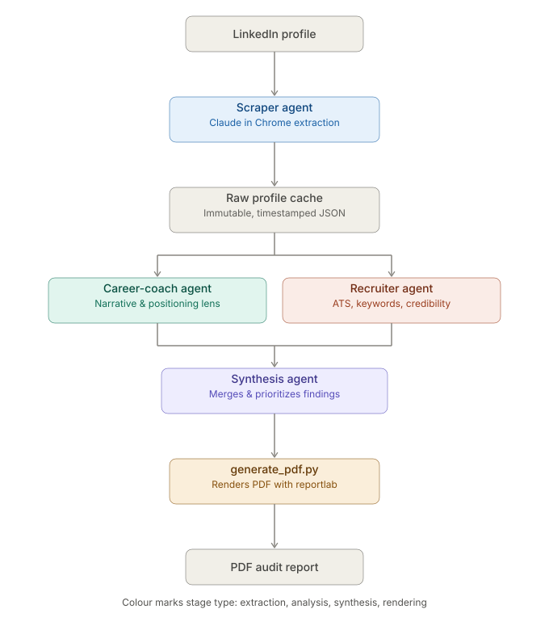

# LinkedIn Profile Audit

A multi-agent Claude Code tool that scrapes a LinkedIn profile and generates a PDF audit report from a career-coach + recruiter lens, including forward-looking 5-year career trajectory guidance.

## How it works

The pipeline is four stages, each a separate Claude Code subagent (or script) with a narrow, well-defined job:

1. **scraper** drives Claude in Chrome to extract a LinkedIn profile — header, about, experience, education, skills, certifications, featured items, recent posts, recommendations, and projects — into a single JSON file conforming to `data/schema.json`.
2. **career-coach** and **recruiter** each read that raw profile JSON independently and in parallel. Neither touches the browser or re-scrapes; they're read-only analysis passes over an already-captured file. career-coach evaluates narrative consistency, positioning, and achievement framing, and also produces a forward-looking 5-year career trajectory (SWOT/FODA, recommended paths, skill recommendations, a quarterly OODA loop). recruiter evaluates the profile the way an ATS or a recruiter doing a 6-second skim would — keyword searchability, skills relevance, credibility signals, and red flags.
3. **synthesis** reads both analysis files, merges and deduplicates overlapping findings into a single prioritized recommendation set (with before/after examples where grounded), and passes career-coach's trajectory guidance through as its own section — separate from the profile-polish recommendations, since it's strategic advice rather than a copy critique.
4. **`scripts/generate_pdf.py`** renders the synthesis output, plus the raw profile and both analysis files, into the final PDF report.

Every scraper run writes a new timestamped file to `data/raw/` (`profile_<YYYYMMDD_HHMMSS>.json`) rather than overwriting the previous one. This raw data is treated as an immutable cache: analysis agents always operate on an existing raw file and never trigger a re-scrape on their own. That means you can re-run career-coach, recruiter, or synthesis as many times as you want — to iterate on prompts, fix a bug, or just get a second read — without needing to touch LinkedIn again.

## Architecture



## Design choices

**Multi-agent over a single monolithic prompt.** Splitting scrape / analyze / synthesize / render into separate agents keeps each one's job small enough to specify precisely, lets career-coach and recruiter run in parallel with genuinely independent perspectives (neither sees the other's output while forming its own), and makes every stage independently re-runnable — you can fix a scraping gap without re-running analysis, or re-run analysis without re-scraping.

**Never fabricate.** This is enforced at every stage. If a field can't be scraped, it's stored as `null` (or an empty list) and named in a `missing_fields` array — never guessed at. Analysis agents treat missing fields as genuinely unknown, not as something to paper over: an empty section still gets a finding (e.g. "no data to evaluate," or the absence itself flagged as a gap), and rewrite suggestions or before/after examples are only produced when there's real text to ground them in.

**This is a probabilistic pipeline, not a deterministic one.** career-coach and recruiter are LLM-based agents, and running the same input through them twice can surface different findings — not because the underlying profile changed, but because LLM output isn't guaranteed to be identical run to run. This showed up directly during development: one career-coach run caught a real factual inconsistency (a recommendation's stated timeline conflicting with the profile's own experience dates), and a subsequent run on the same input missed it. To reduce (not eliminate) that variance, each analysis agent's prompt ends with an explicit "Before finalizing" self-verification checklist — cross-check company names for consistency, cross-check recommendation text against experience dates, confirm every populated section produced at least one finding, confirm trajectory claims trace to real evidence. This is a mitigation, not a guarantee: treat any single run's output as one read of the profile, not a canonical one, and re-run a stage if something looks off.

**Runs entirely locally, via Claude Code + Claude in Chrome.** The scraper stage needs an authenticated, interactive LinkedIn session in a real browser — that can't run headless in CI without either storing LinkedIn credentials/session cookies somewhere (a real security liability) or fighting LinkedIn's bot detection. So there's no GitHub Actions workflow that runs this pipeline; GitHub hosts the code and this README as a showcase, but actually running it requires a human at a machine with Claude Code and Claude in Chrome installed, logged into LinkedIn themselves.

## Tech stack

- **Claude Code** (subagents) — orchestrates the four-stage pipeline
- **Claude in Chrome** — drives the authenticated browser session for scraping
- **Python** — analysis JSON handling and PDF rendering
- **reportlab** — PDF generation (`scripts/generate_pdf.py`)

## Sample output

_Screenshots and a sample PDF will go here._

## Running it yourself

```bash
git clone <this-repo>
cd linkedin-multi-agent-review
python3 -m venv venv
source venv/bin/activate
pip install -r requirements.txt
```

Open the project in Claude Code, then:

1. Confirm you're logged into LinkedIn in the Chrome instance Claude Code will drive (via Claude in Chrome).
2. Run the **scraper** agent with the target profile URL — it writes `data/raw/profile_<timestamp>.json`.
3. Run **career-coach** and **recruiter** on that timestamp — each writes its own file to `data/analysis/`.
4. Run **synthesis** on the same timestamp to merge both into one prioritized report.
5. Run `scripts/generate_pdf.py` (or call `generate_pdf(...)` directly) pointing at the synthesis, raw profile, career-coach, and recruiter files for that timestamp — it renders `output/*.pdf`.

## Limitations

- LinkedIn's DOM occasionally fails text-based extraction — a page can report content is loaded while `get_page_text`/`read_page` returns empty or truncated results. The scraper's procedure (documented in `.claude/agents/scraper.md`) mitigates this with a visual screenshot-and-zoom fallback rather than trusting text extraction alone, but it's a mitigation, not a guarantee the DOM won't misbehave in a new way.
- Analysis quality varies run to run, since career-coach and recruiter are LLM-based and not deterministic — see "Design choices" above.
- This was built as a personal tool and learning project, not a production scraper. If you adapt it, respect LinkedIn's terms of use and your own account's standing — this scrapes an authenticated session under your own login, at your own risk.
