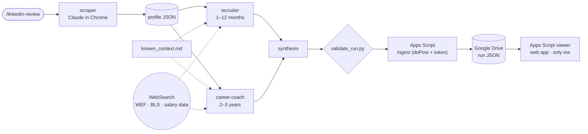

# LinkedIn Review — multi-agent career review

A Claude Code pipeline of four subagents that reviews a LinkedIn profile on
two time horizons and publishes the result to a private web app on Google
Apps Script (desktop + mobile). One command runs it: `/linkedin-review`.

- **Recruiter agent (next 1–12 months):** profile score, skill gaps, paste-ready profile edits, salary bands, search keywords.
- **Career-coach agent (next 2–3 years):** industry, company size, target role, skill mandates, country, IC vs management — grounded in the WEF Future of Jobs report and the US BLS Occupational Outlook Handbook.
- **Every market claim is cited** to a source the agent opened during that run.

<p>
  
  
</p>


> v2 replaced the original PDF report (v1) with the web app, split the agents
> into short-term and long-term scopes, and added a shared "known context"
> file so agents stop re-raising settled facts.

## Agent Office dashboard

A separate 3D view of the pipeline itself rather than its analysis: a Three.js
office where four toy-robot subagents type at retro terminals in a pinwheel
of desks, take coffee breaks when they finish, and a manager robot walks
over to brief each one,
documents fly from desk to desk as the run progresses, and clicking anyone opens
a frosted card with their goal, tokens, cost, time and tool calls.

- **Data:** `scripts/agent_stats.py <RUN_ID>` reads the Claude Code transcripts and writes numbers only (no prompts, no profile content) to `dashboard/data/`. Input and cache tokens are exact; output tokens are estimated from visible text, so cost is an approximate API list-price figure, not a subscription charge. `/linkedin-review` runs it after publishing and pushes the stats.
- **While it replays:** each robot's speech bubble shows what it is doing from its real tool calls (searching, reading a site, writing a file), desk displays count its tool calls and a *Compare runs* panel shows cost and time per agent across runs.
- **Hosting:** static site in `dashboard/`, deployed to GitHub Pages by `.github/workflows/pages.yml` (Settings → Pages → Source: GitHub Actions).
- **Try it locally:** `python3 -m http.server 8765 --directory dashboard`, then open http://localhost:8765.
- Three.js 0.170 is vendored in `dashboard/vendor/` (MIT), so there is no build step or CDN.

## Architecture



| Agent | Tools | Output |
|---|---|---|
| `scraper` | Claude in Chrome | Profile JSON (`data/schema.json`): header, About, experience, skills, certifications, projects, posts with engagement, recommendations |
| `recruiter` | WebSearch, WebFetch | Score /100, scorecard, 11 answered areas, ranked paste-ready `changes`, sources `r*` |
| `career-coach` | WebSearch, WebFetch | 7 strategic answers, 4–6 "master X within N months" mandates, country comparison, market signals, SWOT, skip-for-now, sources `s*` |
| `synthesis` | Read, Write | One schema-v2 run: summary, week / month / quarter plan, changes since last run, notes on agent disagreements |

## Design choices

- **Two horizons, two agents.** Profile tweaks and career strategy pulled each other off course in one prompt. The recruiter owns the profile; the coach is forbidden from commenting on LinkedIn copy.
- **Shared known context.** Confirmed facts (e.g. an employer's rebrand history) live in one file every agent reads first, instead of being patched into each prompt after a bad run.
- **Disagreements are kept, not hidden.** When the two agents give different salary bands or opposite advice, synthesis keeps both and writes a note.
- **Probabilistic, not deterministic.** Two runs on the same profile can differ. Mitigations: cited sources, the known-context file, a scraper "carry-over" rule for lists LinkedIn fails to render, and `validate_run.py` checking ids and references before anything is published.
- **Local by design.** Scraping needs a signed-in, interactive Chrome session, so the pipeline runs on my Mac, not in CI.
- **Private by default.** Raw profiles and runs are gitignored. The viewer web app is deployed "Only myself"; the ingest endpoint is public but needs a secret token and never returns data. Two Apps Script projects keep those two access levels apart.
- **No framework.** The app is one HTML file (vanilla JS, glassmorphism cards, a canvas particle field, light/dark). A small shim maps its data calls to `google.script.run`, so the same file can run elsewhere.

## Tech stack

Claude Code (skills + subagents) · Claude in Chrome · Python 3 standard library · Google Apps Script (HtmlService, ContentService, DriveApp) · Google Drive · vanilla HTML/CSS/JS

## Repo layout

```
.claude/skills/linkedin-review/SKILL.md   orchestrator (/linkedin-review)
.claude/agents/                           scraper, recruiter, career-coach, synthesis
context/known_context.md                  confirmed facts every agent follows
data/schema.json                          profile shape (the rest of data/ is gitignored)
scripts/new_run.py                        run id, paths, previous profile
scripts/validate_run.py                   checks a run before publishing
scripts/publish.py                        POSTs the run to the ingest web app
scripts/agent_stats.py                    per-agent tokens, cost, timing for the dashboard
dashboard/                                Agent Office: Three.js scene, stats JSON, Pages site
apps-script/viewer/                       the app: Code.gs, Index.html, appsscript.json
apps-script/ingest/                       doPost endpoint: Code.gs, appsscript.json
```

## Running it yourself

Requirements: Claude Code with the Claude in Chrome extension, Python 3.9+,
a Google account. Change the profile URL in
`.claude/skills/linkedin-review/SKILL.md` and the facts in
`context/known_context.md` to your own.

### 1. Ingest project (receives runs)
1. [script.google.com](https://script.google.com) → **New project** → name it `LinkedIn Review – ingest`.
2. Replace `Code.gs` with `apps-script/ingest/Code.gs`.
3. **Project Settings** → tick **Show "appsscript.json"** → replace it with `apps-script/ingest/appsscript.json`.
4. Open `Code.gs`, select `setup` → **Run** → authorize. The log prints `FOLDER_ID` and `INGEST_TOKEN`.
5. **Deploy → New deployment → Web app**, Execute as **Me**, access **Anyone**. Copy the `/exec` URL.

### 2. Viewer project (the app)
1. **New project** → `LinkedIn Review`.
2. Replace `Code.gs` with `apps-script/viewer/Code.gs`; add an HTML file `Index` with `apps-script/viewer/Index.html`; replace `appsscript.json` with `apps-script/viewer/appsscript.json`.
3. **Project Settings → Script properties** → add `FOLDER_ID`.
4. **Deploy → New deployment → Web app**, Execute as **Me**, access **Only myself**. Bookmark the URL (on iPhone: Share → Add to Home Screen).

### 3. Local
```bash
cp .env.example .env               # LR_INGEST_URL and LR_INGEST_TOKEN
python3 scripts/publish.py --ping  # expect: OK token accepted
```

### 4. Run
Open Chrome signed in to LinkedIn. In Claude Code (VS Code: type `@browser` or
enable Chrome by default in `/chrome`; terminal: `claude --chrome`):

```
/linkedin-review
```

A run takes about 10–15 minutes; reload the app to see it.

### Updating the app
Edit `apps-script/viewer/Index.html`, paste it into the viewer project, then
**Deploy → Manage deployments → Edit → New version** (the URL stays the same).
Or with [clasp](https://github.com/google/clasp): enable the Apps Script API,
add a gitignored `.clasp.json` (`{"scriptId":"…","rootDir":"."}`) in
`apps-script/viewer/`, then `clasp push && clasp deploy -i <deploymentId>`.

## Limitations

- LinkedIn's lazy-loaded pages sometimes render empty to text tools; the scraper falls back to scrolling, section reads and screenshots, and carries unchanged lists over from the previous run (noted in the run).
- Salary bands come from public surveys and job-board aggregates with different samples; the app shows both agents' figures when they disagree.
- Advice is the agents' judgment from public sources, not a guarantee.

## License

[MIT](LICENSE)
